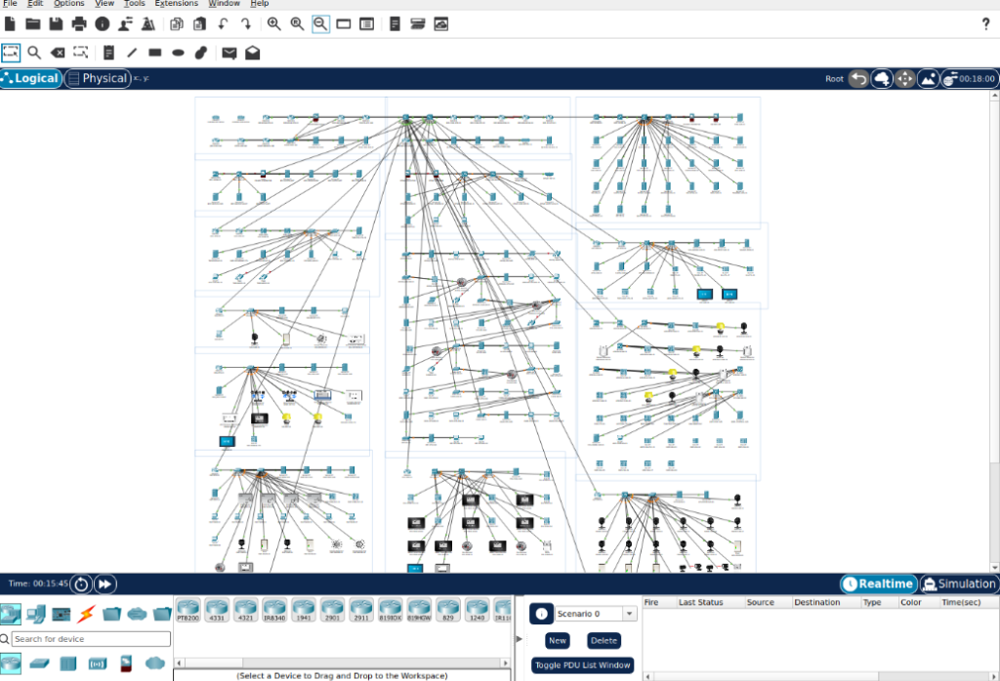

# packet-tracer-pkt-format

离线读取、修改和生成 Cisco Packet Tracer `.pkt` 实验文件与 `.pka` 评分活动，不需要安装 Packet Tracer。

本仓库记录了 Packet Tracer 的文件格式（覆盖 PT 4.1–5.3.2 旧版和 PT 5.3.3–9.0.1 现代容器），提供可将未修改文件逐字节还原的 Python 库（`pkt_core`）、命令行工具（`pkt`）以及离线实验构建器，可以直接生成包含设备、模块、连线、IOS 配置、PC IP、实验说明、活动向导密码和评分树的 `.pkt`/`.pka` 文件。



*由代码生成并在 Packet Tracer 9.0.1 中打开（[IRUMA-AB 与 Y-AMLT 模型](https://github.com/aacanadaa/large-scale-packet-tracer)：386 / 392 台设备，752 条链路，29,073 行配置，共 12 层）。*

[](https://pypi.org/project/packet-tracer-pkt-format/)
[](https://aacanadaa.github.io/packet-tracer-pkt-format/)
[](LICENSE)
[](https://ko-fi.com/suoim)
[](https://www.python.org/)
[](#快速上手)
[](#格式支持)

**Languages:** [English](README.md) | 简体中文

<p align="center">
  
</p>

## 安装

```console
$ pip install packet-tracer-pkt-format
```

需要 Python 3.10+，运行时仅依赖 `pydantic`，不需要安装 Packet Tracer、编译器或系统加密库。库内自带纯 Python 实现的 Twofish、Serpent 和 CAST-256；如果环境中有 `libgcrypt` 或安装了可选的 Rust 扩展（`native/pkt_core_native/`），会自动优先使用加速后端。

## 快速上手

查看、解包和重新打包已有的 `.pkt` 或 `.pka` 文件：

```console
$ pkt info my_lab.pkt
$ pkt export my_lab.pkt --format graphviz -o topology.dot
$ pkt unpack my_lab.pkt -o out/
$ pkt pack out/my_lab.xml -o rebuilt.pkt
```

在 Python 中读取拓扑信息：

```python
from pkt_core import decode
from pkt_core.models import Lab

lab = Lab.from_bytes(decode("my_lab.pkt").xml)
print(len(lab.devices), "devices,", len(lab.links), "links")
for dev in lab.devices:
    print(dev.name, dev.kind, dev.model)
```

## 离线生成实验

`pkt_core.Lab` 内置了基础种子文件和 137 个设备模板，`pip install` 后即可直接生成 `.pkt`：

```python
from pkt_core import Lab

lab = Lab()
lab.prune_seed_devices()
r  = lab.add_device("2911", "R1", 250, 350, install="HWIC-2T",
                    ios_config=["interface GigabitEthernet0/0",
                                " ip address 192.168.1.1 255.255.255.0", " no shutdown", "end"])
sw = lab.add_device("2960-24TT", "SW1", 450, 350)
pc = lab.add_device("PC-PT", "PC1", 650, 350,
                    pc_ip=("192.168.1.10", "255.255.255.0", "192.168.1.1"))
lab.link(r, "GigabitEthernet0/0", sw, "GigabitEthernet0/1")
lab.link(sw, "FastEthernet0/1", pc, "FastEthernet0")
lab.save("my_lab.pkt")
```

如果克隆了本仓库，也可以用 [`tools/`](tools) 里的脚本从 JSON 拓扑描述直接生成带评分和密码的 `.pka`：

```console
$ python3 tools/make_scored_lab.py --out mylab.pka --spec topology.json --password hunter2
```

## 容器格式简介

现代 `.pkt`/`.pka` 文件没有魔数头，整体经过加密和混淆：

```text
.pkt -> [ 字节反转 + 位置 XOR ] -> [ Twofish-EAX, key=0x89*16, iv=0x10*16 ] ->
        [ XOR (len - i) ] -> [ Qt qCompress (4 字节大端长度 + zlib) ] -> UTF-8 XML
```

- **加密算法**：Twofish（Crypto++ EAX 模式），128 位密钥为 `0x89 * 16`，IV 为 `0x10 * 16`，末尾附带 16 字节认证标签。
- **外层混淆（Layer A）**：字节反转后与 `(n * (1 - i)) & 0xff` 异或。
- **内层混淆（Layer B）**：每个字节与 `(len - i) & 0xff` 异或。
- **内部载荷**：Qt `qCompress` 压缩的 UTF-8 XML（根标签通常为 `<PACKETTRACER5>` 或 `<PACKETTRACER5_ACTIVITY>`）。

各格式密钥表和逆向细节见 [FORMAT.md](FORMAT.md)，完整格式规范（含旧版容器）见 [docs/FORMAT_SPECIFICATION.md](docs/FORMAT_SPECIFICATION.md)。

## Python API (`pkt_core`)

```python
from pkt_core import decode, encode_bytes

container = decode("lab.pkt")          # 通过 EAX 标签或旧版探测自动识别格式
print(container.root_tag)              # 'PACKETTRACER5'
print(container.is_activity)           # False (.pka -> PACKETTRACER5_ACTIVITY)

# 传入 original= 时，若 XML 未修改则复用原文件的压缩流，在任何 Python 上都能逐字节还原 lab.pkt。
# 重新压缩的输出仅在经典 zlib 下与 Packet Tracer 逐字节一致（zlib-ng 输出不同但同样有效）。
rebuilt = encode_bytes(container.xml, container.format_name, original=container)
```

| 模块 | 说明 |
| --- | --- |
| `pkt_core.crypto.primitives` | CMAC（RFC 4493）、大端 CTR、Crypto++ EAX |
| `pkt_core.crypto.keys` | 各容器格式的算法、密钥字节与 IV 字节定义 |
| `pkt_core.crypto.stream` | Layer A / Layer B 混淆 |
| `pkt_core.crypto.ciphers_pure` | 纯 Python 的 Twofish、Serpent、CAST-256 |
| `pkt_core.codec.qcompress` | Qt `qCompress` / `qUncompress` 封包 |
| `pkt_core.codec.container` | 容器格式检测、解码和编码 |
| `pkt_core.xml` | 惰性、保留原始字节的 XML 解析器（兼容 PT 特殊字符和内嵌 HTML） |
| `pkt_core.models` | 类型化视图（`Lab`、`Device`、`Port`、`Link`、`Cluster`、`RunningConfig`、服务记录） |
| `pkt_core.builder` | 离线实验构建器（`Lab`、`Layout`） |
| `pkt_core.resources` | 内置设备/模块模板库和种子 XML |
| `pkt_core.audit` | 服务记录统计、重复项检查与模板残留清理 |
| `pkt_core.diff` | 设备、链路和运行配置的语义对比 |
| `pkt_core.export` | 导出为 Graphviz DOT、NetBox JSON 和 containerlab YAML |
| `pkt_core.errors` | 统一异常类型 |

模型对象直接包装底层的 `XmlElement`，未修改的节点在写回时保持原始字节不变，未建模的子元素可通过 `extra_fields` 访问。IOS `<LINE>` 配置保持为 `bytes`，避免破坏 `banner motd ^C...^C` 中的 `\x03` 等控制字符。

测试用的样例文件已提交在 [`corpus/samples/`](corpus/samples/)，无需额外下载即可运行测试。分析用的 1,026 个第三方样本文件不随仓库分发，复现方法见 [`corpus/README.md`](corpus/README.md) 和 [`corpus/fetch_corpus.py`](corpus/fetch_corpus.py)。

## 三种加密后端

| 后端 | Twofish | Serpent | CAST-256 |
| --- | --- | --- | --- |
| **Rust**（可选扩展） | 0.090 µs/块 | 0.151 µs | 0.209 µs |
| libgcrypt | 0.827 µs | 0.885 µs | 不支持 |
| 纯 Python（内置回退） | 13.2 µs | 47.6 µs | 18.7 µs |

三种后端都经过标准测试向量（Twofish AES、Serpent NESSIE、CAST-256 RFC 2612 附录 A）交叉验证，输出逐字节一致。

## 命令行用法

```console
$ pkt info    my_lab.pkt                      # 容器元数据、大小、根标签
$ pkt unpack  my_lab.pkt -o out/              # 导出 XML、各设备 IOS 配置和拓扑图
$ pkt pack    out/my_lab.xml -o rebuilt.pkt   # 将 XML 重新打包为容器
$ pkt pack    out/my_lab.xml -o rebuilt.pkt --original my_lab.pkt   # XML 未修改时逐字节完全还原
$ pkt diff    before.pkt after.pkt            # 语义差异对比
$ pkt export  my_lab.pkt --format graphviz    # 导出 graphviz / netbox / containerlab
$ pkt audit   my_lab.pkt --templates tools/device_templates.json
```

在仓库目录中也可以直接运行单文件参考脚本 `pt9.py`（直接调用 `libgcrypt`，未打包进 PyPI 分发包）：

```console
$ python3 pt9.py info   my_lab.pkt
$ python3 pt9.py decode my_lab.pkt -o my_lab.xml
$ python3 pt9.py encode my_lab.xml -o my_lab.pkt
$ pytest tests/
```

### 审计生成的实验（`pkt audit`）

从真实文件采集的设备模板往往残留默认服务记录（例如默认的 AAA 客户端、`serverPool` DHCP 地址池或默认 FTP 账号）。`pkt audit` 会同时输出原始数量和去重后的数量，配合 `--templates` 标出模板残留项，遇到重复项时返回非零退出码：

```console
$ pkt audit JASDF_AEWC_JADGE.pkt --templates tools/device_templates.json
device_names: 290 raw, 290 distinct
config lines  : min=78 median=143 max=250 total=22,648 (143 IOS/ASA devices,
                by model); 22,896 <LINE> elements in 205 RUNNINGCONFIG blocks
services      : 496 DNS records (248 distinct x 2 servers)
  aaa_clients: 202 raw, 140 distinct, 62 duplicate instances
               (e.g. 192.168.10.1 x63), 63 template leftovers -> 139 authored
  dhcp_pools : 259 raw, 133 distinct, 126 duplicate instances
               (e.g. serverPool / 0.0.0.0 / 0.0.0.0 x65), 128 template leftovers
  ...
RESULT: FAILED (15 failures, 0 warnings)
```

## 格式支持

已在 1,058 个真实容器文件（PT 4.1 至 9.0.1）上验证 `encode(decode(f)) == f` 逐字节一致（详见 [`docs/CORPUS_VERIFICATION.md`](docs/CORPUS_VERIFICATION.md)）：

- **未修改的文件始终可逐字节还原**：将解码得到的容器作为 `original=` 传给 `encode_bytes`/`encode`（或在 `pkt pack` 时传入 `--original`），只要 XML 未改动，就会直接复用原始压缩流，不受 Python 所链接的 zlib 实现影响。
- **重新压缩的输出**（修改过 XML，或未传 `original=`）仅在经典 zlib 下与 Packet Tracer 原始字节完全相同。链接了 zlib-ng 的环境（例如 Windows 官方 CPython 3.14，可通过 `zlib.ZLIB_RUNTIME_VERSION` 查看）会生成不同但同样合法的压缩流，解码后的 XML 完全相同，Packet Tracer 可正常打开。

| 容器家族 | 对应 PT 版本 | 封装流程 | 已验证文件数 |
| --- | --- | --- | ---: |
| 现代 | 5.3.3 – 9.0.1 | layer A → Crypto++ EAX (Twofish) → layer B → qCompress | 865 |
| 旧版 | 4.1 – 5.3.2 | layer B → qCompress（无加密） | 193 |

- 现代容器通过 EAX 标签识别，旧版容器通过 6 字节 `qCompress`/zlib 特征识别。
- 内部 XML 并不严格符合 XML 1.0（包含 `\x03` 等控制字节、PT 4.1 末尾的 NUL 字节以及 `.pka` 中的 HTML 说明），常规严格解析器会报错。
- 常见根元素包括 `PACKETTRACER5`、`PACKETTRACER5_ACTIVITY` 和 `PACKETTRACER_ACTIVITY`（PT 4.x）。
- `pkt_core` 通过内置纯 Python 实现和可选 Rust 扩展完整支持 `.pkt`/`.pka`（Twofish）、`.pta`/`.pkc`（Serpent）以及 `sm`/`userapp`（CAST-256）。`pt9.py` 依赖 `libgcrypt`，支持 Twofish 和 Serpent，不支持 CAST-256。

## 逆向分析简介

对带符号表的 Linux 版 `PacketTracer` 二进制进行静态分析，定位了 `CNetworkFile::openFile`、`Util::encrypt*`/`decrypt*`、`Util::cipher/decipher<Cipher>` 以及 Crypto++ 的 `EAX_Base` / `AuthenticatedDecryptionFilter`；随后在 `Xvfb` + `gdb` 下拦截中间缓冲区，确认了 CTR 计数器格式与两层混淆算法。

## 脚本与大型拓扑

仓库的 [`tools/`](tools) 目录包含更多辅助脚本（相关说明见 [`docs/SCENE_GRAPH.md`](docs/SCENE_GRAPH.md)、[`docs/CONFIGURATION.md`](docs/CONFIGURATION.md)、[`docs/ACTIVITY.md`](docs/ACTIVITY.md) 和 [`docs/CAPABILITIES.md`](docs/CAPABILITIES.md)）：

- `tools/harvest_merge.py`：从现有 `.pkt` 采集各型号设备并合并到同一画布，自动重映射物理工作区。
- `tools/build_wired_lab.py`：采集设备并自动将以太网设备连线到核心交换机。
- `tools/build_configured_lab.py`：生成带完整配置的多路由器实验（`PC1-SW1-R1=R2-SW2-PC2`）。
- `tools/activity.py` + `tools/scoring.py`：编写 `.pka` 评分活动（HTML 说明、向导密码、权限、初始/答案网络、评分树）。
- `tools/make_scored_lab.py`：根据 JSON 拓扑描述一次性生成评分 `.pka`，内置 137 个设备模板、78 个模块模板和 14 种评分形态。
- `tools/harvest_library.py`：从自己的 `.pkt`/`.pka` 文件扩展模板库。
- `demo/build_demo.py`：6 设备 OSPF 示例，直接 `pip install` 后即可运行。

使用这套工具链生成的两个大型企业级拓扑（已在 PT 9.0.1 中验证打开）位于 [`large-scale-packet-tracer`](https://github.com/aacanadaa/large-scale-packet-tracer)：

| 网络 | 设备数 | 链路数 | 配置行数 | 文件大小 |
| --- | ---: | ---: | ---: | ---: |
| Y-AMLT（横滨海运码头） | 386 | 380 | 15,345 | 1.33 MB |
| IRUMA-AB（航空自卫队基地） | 392 | 372 | 13,728 | 1.40 MB |

完整文档站点见 [aacanadaa.github.io/packet-tracer-pkt-format](https://aacanadaa.github.io/packet-tracer-pkt-format/)。

## 参考文档

| 文档 | 内容 |
| --- | --- |
| [FORMAT_SPECIFICATION.md](docs/FORMAT_SPECIFICATION.md) | 两种容器家族的完整二进制格式规范 |
| [SCHEMA_REFERENCE.md](docs/SCHEMA_REFERENCE.md) | 1,285 个 XML 元素名参考 |
| [LEGACY_FORMAT.md](docs/LEGACY_FORMAT.md) | PT 5.x 旧版容器分析说明 |
| [CORPUS_VERIFICATION.md](docs/CORPUS_VERIFICATION.md) | 1,058/1,058 逐字节验证报告 |
| [PKA_GENERATION.md](docs/PKA_GENERATION.md) | 离线生成评分 `.pka` 指南 |
| [LARGE_TOPOLOGY_TEST.md](docs/LARGE_TOPOLOGY_TEST.md) | 77 设备大型拓扑测试记录 |
| [PACKET_TRACER_VALIDATION.md](docs/PACKET_TRACER_VALIDATION.md) | Packet Tracer 实测验证 |

## 法律与合规说明

- 本项目用于文件格式互操作性研究、文档记录、工具开发与个人实验归档，分析基于本地合法授权的 Packet Tracer 与作者自己的文件。
- 不涉及绕过 DRM 或软件授权保护；容器使用固定密钥，不含用户加密口令。
- 请勿用于获取、篡改或提交考试、评测或竞赛答案。

## 许可证

**GNU General Public License v3.0 或更高版本**（见 [LICENSE](LICENSE)）。遵循 GPLv3 条款即可自由使用、修改和再分发，包括用于商业用途。

## Star history

<a href="https://www.star-history.com/?repos=aacanadaa%2Fpacket-tracer-pkt-format&type=date&legend=top-left">
  <picture>
    <source media="(prefers-color-scheme: dark)" srcset="https://api.star-history.com/chart?repos=aacanadaa/packet-tracer-pkt-format&type=date&theme=dark&legend=top-left" />
    <source media="(prefers-color-scheme: light)" srcset="https://api.star-history.com/chart?repos=aacanadaa/packet-tracer-pkt-format&type=date&legend=top-left" />
    
  </picture>
</a>

## Commit history

<a href="https://github.com/aacanadaa/packet-tracer-pkt-format/graphs/contributors">
  <picture>
    <source media="(prefers-color-scheme: dark)" srcset="docs/img/commit-history-dark.svg" />
    <source media="(prefers-color-scheme: light)" srcset="docs/img/commit-history-light.svg" />
    
  </picture>
</a>

---

如果这个项目帮到了你，欢迎请我喝杯咖啡：

[](https://ko-fi.com/suoim)

