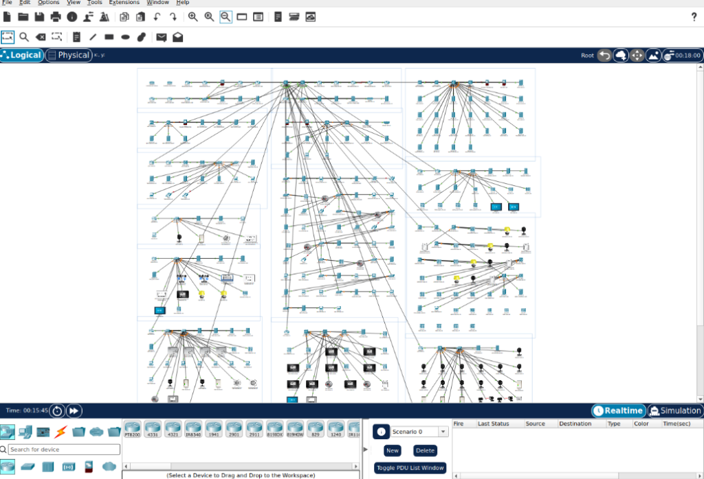
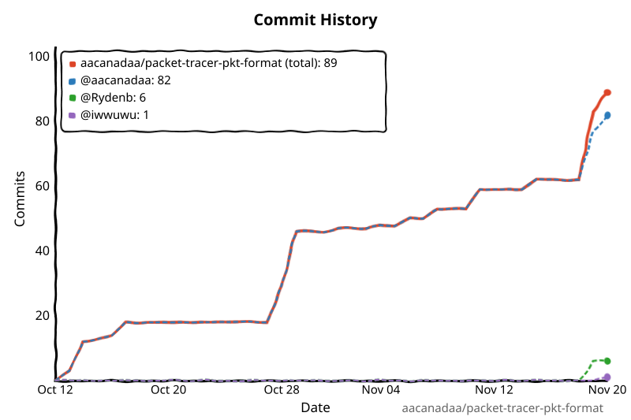

# packet-tracer-pkt-format

Packet Tracer をインストールせずに、オフラインで Cisco Packet Tracer の `.pkt` ラボファイルや `.pka` 採点付きアクティビティを読み取り・編集・生成できます。

本リポジトリは、Packet Tracer のファイル形式（旧形式の PT 4.1–5.3.2 および現代の PT 5.3.3–9.0.1 コンテナの両方）を文書化し、未変更のファイルをバイト単位で完全往復（ラウンドトリップ）できる Python ライブラリ（`pkt_core`）、CLI（`pkt`）、および機器・モジュール・ケーブル・IOS 設定・PC の IP・課題説明文・Activity Wizard パスワード・採点ツリーを `.pkt`/`.pka` ファイルへ直接書き出すオフラインラボビルダーを提供します。



*コードから生成し、Packet Tracer 9.0.1 で開いた画面（[IRUMA-AB および Y-AMLT モデル](https://github.com/aacanadaa/large-scale-packet-tracer)：386 台および 392 台の機器、752 リンク、12 階層にわたる 29,073 行の設定）。*

[](https://pypi.org/project/packet-tracer-pkt-format/)
[](https://aacanadaa.github.io/packet-tracer-pkt-format/)
[](LICENSE)
[](https://ko-fi.com/suoim)
[](https://www.python.org/)
[](#クイックスタート)
[](#対応フォーマット)

**Languages:** [English](README.md) | [简体中文](README.zh-CN.md) | 日本語

<p align="center">
  
</p>

## インストール

```console
$ pip install packet-tracer-pkt-format
```

Python 3.10 以上と `pydantic` が必要です。Packet Tracer 本体、コンパイラ、システムの暗号ライブラリは不要です。ピュア Python による Twofish、Serpent、CAST-256 実装を内蔵しており、`libgcrypt` または任意の Rust 拡張（`native/pkt_core_native/`）がインストールされている環境では、高速化のため自動的にそれらが使用されます。

## クイックスタート

既存の `.pkt` または `.pka` ファイルの確認、展開、再パック：

```console
$ pkt info my_lab.pkt
$ pkt export my_lab.pkt --format graphviz -o topology.dot
$ pkt unpack my_lab.pkt -o out/
$ pkt pack out/my_lab.xml -o rebuilt.pkt
```

Python からラボを読み取る：

```python
from pkt_core import decode
from pkt_core.models import Lab

lab = Lab.from_bytes(decode("my_lab.pkt").xml)
print(len(lab.devices), "devices,", len(lab.links), "links")
for dev in lab.devices:
    print(dev.name, dev.kind, dev.model)
```

## オフラインでのラボ構築

`pkt_core.Lab` にはシードドキュメントと 137 種類の機器テンプレートが同梱されているため、`pip install` 直後から `.pkt` ファイルを生成できます：

```python
from pkt_core import Lab

lab = Lab()
lab.prune_seed_devices()
r  = lab.add_device("2911", "R1", 250, 350, install="HWIC-2T",
                    ios_config=["interface GigabitEthernet0/0",
                                " ip address 192.168.1.1 255.255.255.0", " no shutdown", "end"])
sw = lab.add_device("2960-24TT", "SW1", 450, 350)
pc = lab.add_device("PC-PT", "PC1", 650, 350,
                    pc_ip=("192.168.1.10", "255.255.255.0", "192.168.1.1"))
lab.link(r, "GigabitEthernet0/0", sw, "GigabitEthernet0/1")
lab.link(sw, "FastEthernet0/1", pc, "FastEthernet0")
lab.save("my_lab.pkt")
```

リポジトリをチェックアウトしている場合は、[`tools/`](tools) を使用して JSON トポロジ定義から採点付きの `.pka` アクティビティを生成することもできます：

```console
$ python3 tools/make_scored_lab.py --out mylab.pka --spec topology.json --password hunter2
```

## コンテナ形式の概要

現代の `.pkt`/`.pka` ファイルにはマジックヘッダがなく、ファイル全体が暗号化・難読化されています：

```text
.pkt -> [ バイト反転 + XOR ] -> [ Twofish-EAX, key=0x89*16, iv=0x10*16 ] ->
        [ XOR (len - i) ] -> [ Qt qCompress (4 バイト BE 長 + zlib) ] -> UTF-8 XML
```

- **暗号アルゴリズム**：Crypto++ EAX モードの Twofish（128 ビット鍵 `0x89 * 16`、IV `0x10 * 16`、末尾に 16 バイトの認証タグ）。
- **外側の難読化（Layer A）**：バイト列を反転し、`(n * (1 - i)) & 0xff` と XOR。
- **内側の難読化（Layer B）**：各バイトを `(len - i) & 0xff` と XOR。
- **ペイロード**：UTF-8 XML（`<PACKETTRACER5>` または `<PACKETTRACER5_ACTIVITY>`）をラップした Qt `qCompress`。

鍵の一覧およびリバースエンジニアリングの詳細は [FORMAT.md](FORMAT.md) を、現代・旧形式の両コンテナを網羅した完全な仕様は [docs/FORMAT_SPECIFICATION.md](docs/FORMAT_SPECIFICATION.md) を参照してください。

## Python API (`pkt_core`)

```python
from pkt_core import decode, encode_bytes

container = decode("lab.pkt")          # EAX タグまたは旧形式プローブによりフォーマットを自動判別
print(container.root_tag)              # 'PACKETTRACER5'
print(container.is_activity)           # False (.pka -> PACKETTRACER5_ACTIVITY)

# 再エンコード。original= を渡すと、XML が未変更の間は元ファイルの圧縮ストリームを
# 再利用するため、どの Python 環境でも lab.pkt をバイト単位で完全に再現します。
rebuilt = encode_bytes(container.xml, container.format_name, original=container)
```

| モジュール | 役割 |
| --- | --- |
| `pkt_core.crypto.primitives` | CMAC（RFC 4493）、ビッグエンディアン CTR、Crypto++ EAX |
| `pkt_core.crypto.keys` | フォーマットごとの暗号アルゴリズム、鍵バイト、IV バイト定義 |
| `pkt_core.crypto.stream` | Layer A および Layer B の難読化処理 |
| `pkt_core.crypto.ciphers_pure` | ピュア Python による Twofish、Serpent、CAST-256 |
| `pkt_core.codec.qcompress` | Qt `qCompress` / `qUncompress` フレーミング |
| `pkt_core.codec.container` | フォーマット検出、デコード、エンコード |
| `pkt_core.xml` | 遅延評価・バイト保持型 XML パーサ（PT 固有の仕様や埋め込み HTML を許容） |
| `pkt_core.models` | 型付きビュー（`Lab`、`Device`、`Port`、`Link`、`Cluster`、`RunningConfig`、各種サービス） |
| `pkt_core.builder` | オフラインラボビルダー（`Lab`、`Layout`） |
| `pkt_core.resources` | 同梱の機器・モジュールテンプレートライブラリおよびシード XML |
| `pkt_core.audit` | サービス一覧集計、重複検出、テンプレート残存データのサニタイザ |
| `pkt_core.diff` | 機器、リンク、running-config のセマンティック差分 |
| `pkt_core.export` | Graphviz DOT、NetBox JSON、containerlab YAML へのエクスポート |
| `pkt_core.errors` | パッケージの例外階層 |

各モデルは基底の `XmlElement` ノードを直接ラップするため、変更していないセクションは元のバイト列のままシリアライズされ、未知のタグにも `extra_fields` からアクセスできます。IOS の `<LINE>` エントリは、`banner motd ^C...^C` に含まれる `\x03` などの生の制御文字を保持するため `bytes` のまま扱われます。

本リポジトリで生成したテスト用サンプルコンテナは [`corpus/samples/`](corpus/samples/) に収録されており、そのままテストを実行できます。解析に使用したサードパーティのコーパスファイルはリポジトリに含まれていません。詳細は [`corpus/README.md`](corpus/README.md) および [`corpus/fetch_corpus.py`](corpus/fetch_corpus.py) を参照してください。

## CLI の使い方

```console
$ pkt info    my_lab.pkt                      # コンテナのメタデータ、サイズ、ルートタグ
$ pkt unpack  my_lab.pkt -o out/              # XML、機器ごとの IOS 設定、トポロジを展開
$ pkt pack    out/my_lab.xml -o rebuilt.pkt   # XML をコンテナに再パック
$ pkt pack    out/my_lab.xml -o rebuilt.pkt --original my_lab.pkt   # XML 未変更時に完全一致のコピーを生成
$ pkt diff    before.pkt after.pkt            # セマンティック差分
$ pkt export  my_lab.pkt --format graphviz    # graphviz / netbox / containerlab 出力
$ pkt audit   my_lab.pkt --templates tools/device_templates.json
```

リポジトリのチェックアウトからは、`libgcrypt` を直接バインドする単体スクリプト `pt9.py`（PyPI パッケージには含まれません）も利用できます：

```console
$ python3 pt9.py info   my_lab.pkt
$ python3 pt9.py decode my_lab.pkt -o my_lab.xml
$ python3 pt9.py encode my_lab.xml -o my_lab.pkt
$ pytest tests/
```

### 生成したラボの監査（`pkt audit`）

実ファイルから抽出した機器テンプレートには、デフォルトのサービスレコード（デフォルトの AAA クライアント、`serverPool` DHCP プール、デフォルトの FTP アカウントなど）が残存していることがあります。`pkt audit` は機器、IP、設定行、サービスの総数（raw）と重複除外数（distinct）を集計し、`--templates` 指定時にはテンプレート由来の残存データを検出して、重複がある場合は非ゼロの終了コードを返します：

```console
$ pkt audit JASDF_AEWC_JADGE.pkt --templates tools/device_templates.json
device_names: 290 raw, 290 distinct
config lines  : min=78 median=143 max=250 total=22,648 (143 IOS/ASA devices,
                by model); 22,896 <LINE> elements in 205 RUNNINGCONFIG blocks
services      : 496 DNS records (248 distinct x 2 servers)
  aaa_clients: 202 raw, 140 distinct, 62 duplicate instances
               (e.g. 192.168.10.1 x63), 63 template leftovers -> 139 authored
  dhcp_pools : 259 raw, 133 distinct, 126 duplicate instances
               (e.g. serverPool / 0.0.0.0 / 0.0.0.0 x65), 128 template leftovers
  ...
RESULT: FAILED (15 failures, 0 warnings)
```

## 対応フォーマット

PT 4.1 から 9.0.1 までの実コンテナ 1,058 個すべてにおいて、バイト単位の完全一致（`encode(decode(f)) == f`）を検証済みです（[`docs/CORPUS_VERIFICATION.md`](docs/CORPUS_VERIFICATION.md) 参照）：

- **未変更のファイルは常にバイト単位で完全往復します。** デコードしたコンテナを `encode_bytes`/`encode` の `original=`（または `pkt pack` の `--original`）に渡すと、XML が変更されていない限り元の圧縮ストリームが再利用されるため、Python がリンクしている zlib の実装に関わらず同一のバイト列になります。
- **新規に圧縮された出力**（XML を編集した場合や `original=` を指定しない場合）は、Python が従来の zlib を使用している場合にのみ Packet Tracer の出力バイト列と一致します。公式の Windows 版 CPython 3.14 など zlib-ng にリンクされたビルド（`zlib.ZLIB_RUNTIME_VERSION` で確認可能）では、異なるものの仕様上まったく有効な圧縮ストリームが生成され、同じ XML にデコードでき Packet Tracer でも問題なく開けます。

| 系統 | PT バージョン | 変換パイプライン | 検証済みファイル数 |
| --- | --- | --- | ---: |
| 現代（Modern） | 5.3.3 – 9.0.1 | layer A → Crypto++ EAX (Twofish) → layer B → qCompress | 865 |
| 旧形式（Legacy） | 4.1 – 5.3.2 | layer B → qCompress（暗号化なし） | 193 |

- フォーマット判別には、現代のファイルでは EAX タグを、旧形式のファイルでは 6 バイトの `qCompress`/zlib プローブを使用します。
- 内部の XML は厳密な XML 1.0 準拠ではありません（生の `\x03` バナーバイト、PT 4.1 ファイル末尾の NUL バイト、`.pka` 説明文に埋め込まれた HTML など）。そのため、一般的な検証付き XML パーサでは実際のファイルを読み込めません。
- ルート要素は `PACKETTRACER5`、`PACKETTRACER5_ACTIVITY`、および `PACKETTRACER_ACTIVITY`（PT 4.x）です。
- `pkt_core` はピュア Python 暗号実装および任意の Rust 拡張により、`.pkt`/`.pka`（Twofish）、`.pta`/`.pkc`（Serpent）、`sm`/`userapp`（CAST-256）をサポートします。`pt9.py` は `libgcrypt` を使用するため、Twofish と Serpent に対応し CAST-256 には対応していません。

## リバースエンジニアリングのノート

シンボル付きの Linux 版 `PacketTracer` バイナリを静的解析し、`CNetworkFile::openFile`、`Util::encrypt*`/`decrypt*`、`Util::cipher/decipher<Cipher>`、および Crypto++ の `EAX_Base` / `AuthenticatedDecryptionFilter` を特定しました。さらに `Xvfb` 上で Packet Tracer を実行し、`gdb` のブレークポイントで中間バッファを正確に取得することで、CTR カウンタの構造と両方の難読化レイヤを検証しました。

## スクリプトと大規模トポロジ

[`tools/`](tools) には追加のオーサリング用スクリプトが用意されています（[`docs/SCENE_GRAPH.md`](docs/SCENE_GRAPH.md)、[`docs/CONFIGURATION.md`](docs/CONFIGURATION.md)、[`docs/ACTIVITY.md`](docs/ACTIVITY.md)、[`docs/CAPABILITIES.md`](docs/CAPABILITIES.md) を参照）：

- `tools/harvest_merge.py` — 既存の `.pkt` ファイルからモデルごとに 1 台ずつ機器を抽出し、物理ワークスペースを再マッピングして 1 つのキャンバスに統合します。
- `tools/build_wired_lab.py` — 機器を抽出し、イーサネット対応機器をコアスイッチへ自動配線します。
- `tools/build_configured_lab.py` — 設定済みのマルチルータラボ（`PC1-SW1-R1=R2-SW2-PC2`）を構築します。
- `tools/activity.py` + `tools/scoring.py` — `.pka` アクティビティ（HTML 説明文、ウィザードパスワード、権限、初期/解答ネットワーク、採点ツリー）を作成します。
- `tools/make_scored_lab.py` — 同梱の 137 種類の機器テンプレート、78 種類のモジュールテンプレート、14 種類の採点シェイプを用いて、JSON トポロジ定義から採点付き `.pka` を生成します。
- `tools/harvest_library.py` — 手持ちの `.pkt`/`.pka` ファイルからテンプレートライブラリを拡張します。
- `demo/build_demo.py` — `pip install` だけで実行できる、6 台構成の小規模な OSPF デモです。

このツールチェーンで構築され、PT 9.0.1 で動作確認済みの 2 つの大規模ネットワークが [`large-scale-packet-tracer`](https://github.com/aacanadaa/large-scale-packet-tracer) で公開されています：

| ネットワーク | 機器数 | リンク数 | 設定行数 | サイズ |
| --- | ---: | ---: | ---: | ---: |
| Y-AMLT（横浜海上物流ターミナル） | 386 | 380 | 15,345 | 1.33 MB |
| IRUMA-AB（航空自衛隊入間基地） | 392 | 372 | 13,728 | 1.40 MB |

完全なフォーマット仕様、スキーマドキュメント、および検証レポートは [aacanadaa.github.io/packet-tracer-pkt-format](https://aacanadaa.github.io/packet-tracer-pkt-format/) で公開されています。

## 法的および倫理的な利用について

- 本プロジェクトは、正規にライセンスされたローカルの Packet Tracer 環境および作成者自身のファイルを用いて、相互運用性、フォーマットの文書化、ツール開発、およびアーカイブを目的として開発されました。
- DRM やライセンス保護の回避は一切行いません。コンテナの鍵は固定されており、ユーザーによる暗号化パスワードは存在しません。
- 試験、評価課題、競技会などの解答を抽出・改ざん・提出する目的でこのツールを使用しないでください。

## ライセンス

**GNU General Public License v3.0 以降**（[LICENSE](LICENSE)）。GPLv3 の条件のもとで、商用利用、改変、および再配布が認められています。

## Star history

<a href="https://www.star-history.com/?repos=aacanadaa%2Fpacket-tracer-pkt-format&type=date&legend=top-left">
  <picture>
    <source media="(prefers-color-scheme: dark)" srcset="https://api.star-history.com/chart?repos=aacanadaa/packet-tracer-pkt-format&type=date&theme=dark&legend=top-left" />
    <source media="(prefers-color-scheme: light)" srcset="https://api.star-history.com/chart?repos=aacanadaa/packet-tracer-pkt-format&type=date&legend=top-left" />
    
  </picture>
</a>

## Commit history

<a href="https://github.com/aacanadaa/packet-tracer-pkt-format/graphs/contributors">
  <picture>
    <source media="(prefers-color-scheme: dark)" srcset="https://raw.githubusercontent.com/aacanadaa/packet-tracer-pkt-format/commit-history-assets/commit-history-dark.svg" />
    <source media="(prefers-color-scheme: light)" srcset="https://raw.githubusercontent.com/aacanadaa/packet-tracer-pkt-format/commit-history-assets/commit-history-light.svg" />
    
  </picture>
</a>

